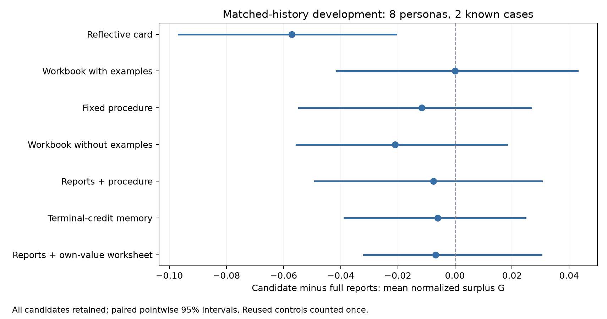

# Matched-history coaching: first prospective confirmation

The prespecified workbook-versus-reports comparison **did not improve transfer**:
mean difference **−0.000114**, persona-bootstrap 95% interval **[−0.033284, +0.029721]**.
This does not establish either superiority or equivalence. All seven personas and both
fresh test cases are included. The method and primary comparison were frozen before
test outcomes; the result is retained despite being negative.

## Design and outcomes

Seven fresh personas (seed 28221129) received one shared five-session reports-guided Sim3
history each. Four frozen memories were assessed with new actors retaining their original
persona parameters: reports, a consolidated workbook with two historical examples, the
fixed decision procedure alone, and the workbook without examples. Actor model, point
tables, counterpart schedule and seeds were matched. Each case score averages tiers 1/3/5.

Harbor Analytics and Maple Festival were original synthetic cases frozen before development.
Their utilities are modeling assumptions. Sim4 had already been inspected and was used as
a revisited development benchmark, not relabeled as an untouched test. The primary endpoint
averages the two fresh-case outcomes within each persona; the sample size is seven.

| Condition | Final mean G | Gain over baseline | Pointwise 95% interval for gain |
|---|---:|---:|---|
| Reports | 0.146768 | +0.005088 | [−0.055119, +0.059790] |
| Workbook | 0.146655 | +0.004975 | [−0.054644, +0.059182] |
| Fixed procedure | 0.168831 | +0.027151 | [−0.005301, +0.058404] |
| Workbook without examples | 0.132699 | −0.008981 | [−0.053532, +0.025347] |

The shared baseline mean is 0.141680. Fixed instructions have the highest point estimate,
but their advantage over reports is +0.022063 with interval [−0.011051, +0.056904]. This
secondary comparison does not establish superiority. The first case favors the workbook
over reports; the second reverses that result. Neither case is dropped.

All 77 training-case episodes agreed above walk-away. Of 210 fresh-case episodes, 208
agreed and two baseline episodes ended in impasse. There were 39 below-walk-away agreements:
baseline 7, reports 10, workbook 5, fixed procedure 7, no-example workbook 10. Negative
scores and impasses remain in the analysis. No counterpart schedule violations or API
execution failures occurred in confirmation. Independent enumeration verifies all 287
episode outcomes, seeds, tiers, training curves and frozen memory hashes.

## Development evidence and limits

Eight development personas were assessed on hiring and Sim4. The workbook improved hiring
in both cohorts but showed mixed Sim4 transfer. Selecting each persona's highest-scoring
memory on hiring also failed to improve pooled Sim4 results. Two ablations—removing
examples and adding the procedure to full reports—did not improve aggregate development
performance. These results, including one recovered provider refusal, remain in the
[chronological design log](ckpt3-improvement.md) and versioned numeric artifacts.

This study measures contextual adaptation of one LLM persona model, not human learning,
model-weight updates or durable skills without retained memory. Seven personas and two
hand-authored cases give limited external validity. Secondary intervals are pointwise,
and candidate selection used development outcomes. Compactness is not evidence of
equivalence or lower total per-method API cost.

## Cost and caching

Confirmation used 3,928 API calls, 21,766,862 input tokens including cache reads/writes,
and 1,469,120 output tokens. Cache reads covered 82.87% of input tokens. Usage-estimated
cost was $34.585371; the rounded per-request ledger increment was **$34.587048**.
The same-token-volume uncached estimate was $78.479610: approximately **$43.89 saved**.

| Scope | Recorded cost | Remaining authorized allowance |
|---|---:|---:|
| New improvement development | $47.080589 | — |
| New confirmation | $34.587048 | — |
| This improvement attempt | **$81.667637** | — |
| Cumulative development ledger | $56.244189 | $43.755811 of $100 |
| Cumulative final ledger | $75.720829 | $24.279171 of $100 |

The cumulative checkpoint-3 total is $131.965018, including earlier work. These are
experiment usage-based estimates, not a provider invoice. No unresolved requests remain
in these two ledgers. Older project-ledger uncertainty is separate and has not been cleared.

## Subsequent development comparisons

An offline diagnostic found that only eight of sixteen large-concession examples had
positive counterfactual evidence of a better eventual outcome. A follow-up selected
historical lessons by modeled terminal credit, retaining its uncertainty. A second added
an exact current-case own-value worksheet to all five reports. Neither advanced under
the rule recorded before its calls: beat reports in both pooled development and the
separate users 4–7 validation mean. Each used 48 new assessment episodes and 144 exact
reused controls across hiring and the revisited Sim4 benchmark.

| Candidate | Paired difference from reports, n=8 | Pointwise 95% interval | Validation difference, n=4 | New ledger cost |
|---|---:|---|---:|---:|
| Terminal-credit memory | −0.006090 | [−0.038723, +0.024703] | −0.016787 | $7.427020 |
| Reports + own-value worksheet | −0.006771 | [−0.031893, +0.030233] | −0.023277 | $7.083665 |

Cases are averaged within persona. These are repeated exploratory comparisons on known
cases, not independent confirmations. All failures and both cohorts are retained. The
worksheet validation interval is [−0.037901, −0.008654], so its negative result cannot
be dismissed by citing the positive first-cohort mean. Neither candidate used final-budget
calls or generated Beacon Museum assessment outcomes. Their code, frozen histories,
verified analyses and selection decisions are versioned.

The complete matched-history comparison is reproduced by
`scripts/compare_coaching_candidates.py`. Its paired plot retains all seven alternatives
to reports and deduplicates reused controls:

None has an interval wholly above zero. The reflective card is worse on this development
comparison (−0.057071, pointwise interval [−0.096655, −0.020683]). These intervals are not
adjusted for the repeated exploratory comparisons.

The next prespecified comparison keeps five practice sessions but changes their variety:
two shared Sim3 sessions followed by hiring/Sim4/hiring, versus five Sim3 sessions. This
tests the curriculum as a package, not prompt refinement from identical histories.
Development assesses all eight original personas on the already-seen Harbor case; only
an advancing candidate may use the still-unused Beacon case. See the chronological log
for the selection rule, separate budgets and prospective follow-up limitations.

Artifacts: `results/ckpt3/consolidation-final-v1/verified_analysis.json` and
`results/ckpt3/consolidation-final-v1/paired_gains.png`. Source/protocol history and exact
commands are recorded in `logs/ckpt3-improvement.md` and the frozen protocol JSON.
